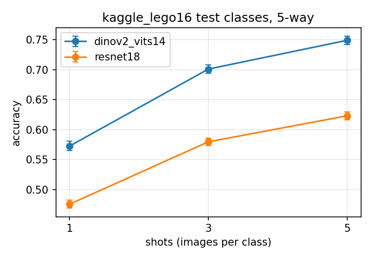

# 실험 2: few-shot 블록 인식

## 1. 목적

**새 블록을 재학습 없이 사진 몇 장 등록만으로 알아볼 수 있는가**, 그리고 그때 필요한 사진 수·추가 시간이 재학습 방식(YOLO)보다 얼마나 적은가를 보인다.

- 헤드는 기존 블록으로 **한 번만** 학습하고, 새 블록은 재학습 없이 사진 1~5장을 **등록만** 한다.
- 백본은 ResNet18과 DINOv2 ViT-S/14를 같이 돌려 성능·속도로 정한다 (11/2 멘토링: "DINOv2가 과하다" → 가벼운 쪽이 충분하면 그걸 쓴다).

## 2. 비교 방법

| 방법 | 학습하는 것 | 새 블록 추가 방법 | 상태 |
| --- | --- | --- | --- |
| HSV 색 규칙 | 없음 | 색 범위 규칙 추가 | 예정 |
| YOLO11n-cls | 모델 전체 | 블록당 5/20/50/150장으로 **재학습** | 예정 |
| ResNet18 단독 | 없음 (ImageNet 가중치 고정) | 사진 K장 등록 | ✅ 예비 결과 |
| DINOv2 단독 | 없음 (사전학습 가중치 고정) | 사진 K장 등록 | ✅ 예비 결과 |
| 백본 + 헤드 | 작은 헤드만 (메트릭 러닝, head_train 10종) | 사진 K장 등록 | 예정 |
| 백본 + 헤드 + 색·면적 (최종) | 헤드 | 사진 K장 등록 | 예정 (D1) |

"등록"은 학습이 아니다. 사진 K장을 백본(+헤드)에 넣어 나온 특징 벡터의 평균을 그 블록의 대표값(프로토타입)으로 저장할 뿐이다.

## 3. 데이터와 분할

### 공개 데이터: Kaggle "Images of LEGO Bricks" v1

- 출처: [`joosthazelzet/lego-brick-images`](https://www.kaggle.com/datasets/joosthazelzet/lego-brick-images) 의 `LEGO brick images v1/` (16종, 종류당 약 400장, 3D 렌더링). 같은 데이터셋의 `dataset/`(v2, 50종)은 쓰지 않는다. Kaggle 노트북에서는 `/kaggle/input/datasets/joosthazelzet/lego-brick-images/LEGO brick images` 로 붙었다 (스크립트가 자동 탐색).
- **블록 종류 단위**로 나눈다 (seed 0, [`splits/kaggle_classes.yaml`](../../splits/kaggle_classes.yaml)). 시험 6종은 헤드 학습에 한 번도 쓰지 않으므로 모델 입장에서 "처음 보는 새 블록"이다.

| 용도 | 블록 |
| --- | --- |
| head_train (10종) | 11214 Bush 3M friction with Cross axle, 3003 Brick 2x2, 3004 Brick 1x2, 3022 Plate 2x2, 3023 Plate 1x2, 3024 Plate 1x1, 32123 half Bush, 3673 Peg 2M, 3713 Bush for Cross Axle, 6632 Technic Lever 3M |
| test (6종) | 18651 Cross Axle 2M with Snap friction, 2357 Brick corner 1x2x2, 3005 Brick 1x1, 3040 Roof Tile 1x2x45deg, 3069 Flat Tile 1x2, 3794 Plate 1X2 with 1 Knob |

### 자체 데이터: D1 (예정)

기본 6종(`R2x2 R2x4 B2x2 B2x4 Y2x2 Y2x8`) + 새 블록 2종(경사 2x2 `R2x2S B2x2S`)의 웹캠 크롭. 새 블록 2종은 헤드 학습·설정 조정에 쓰지 않는다. 핵심 비교는 `R2x2 ↔ R2x2S`(같은 색·같은 면적·다른 모양)로, 색 규칙과 면적으로는 구분할 수 없다. 형식은 [docs/data_format.md](../../docs/data_format.md) 7절.

## 4. 평가 절차 (5-way K-shot)

한 판(에피소드):

1. 시험 6종 중 **5종**을 뽑는다.
2. 5종 각각에서 사진 **K장(1·3·5)** 을 등록한다 → 종류별 프로토타입 5개.
3. 5종 각각에서 등록에 안 쓴 다른 사진 **15장**씩, 총 **75장**을 문제로 낸다.
4. 각 문제 사진을 프로토타입 5개와 코사인 유사도로 비교해 가장 가까운 종류로 답한다.
5. 그 판의 정확도 = 맞힌 장수 / 75.

이걸 **600판** 반복해 평균을 낸다. 판마다 뽑히는 5종이 달라서 6종 모두 골고루 시험된다.

- 600판 구성은 [`splits/fewshot_episodes_seed0.json`](../../splits/fewshot_episodes_seed0.json)에 고정한다. 모든 방법(백본 단독, +헤드, YOLO)이 **같은 600판**으로 평가된다.
- 5-way는 few-shot 연구의 표준 설정이라 관련 연구 수치와 비교하기 위해 쓴다. 실제 시스템은 8종(기본 6 + 새 2) 중 하나를 고르는 문제이므로 D1에서 따로 잰다.
- 우연히 맞힐 확률은 1/5 = 20%.

## 5. 지표

| 지표 | 정의 |
| --- | --- |
| `accuracy_mean` | 600판 정확도 평균 |
| `accuracy_std` | 판마다 정확도가 흔들리는 정도 (평균의 불확실성이 아님) |
| 95% 신뢰구간 | 1.96 × std / √600, 결과 `.yaml` 의 `accuracy_ci95` |
| `train_images_per_class` | 블록당 학습에 쓴 사진 수 (등록 방식은 0, YOLO는 5/20/50/150) |
| `add_block_sec` | 새 블록 하나 추가에 걸리는 시간. 등록 방식은 K장 임베딩 시간, YOLO는 재학습 시간 |
| 장당 처리 시간 | 사진 1장 임베딩 ms (배치 1, 전처리 포함). 최종 비교는 **노트북 CPU** 기준 |

## 6. 실행

```bash
# 로컬 (데이터 경로 지정)
python experiments/exp2_recog/backbone_fewshot.py --data-root "<...>/LEGO brick images v1"

# Kaggle: kaggle/exp2_backbone/exp2_backbone.ipynb 를 Import
#   Add Input → joosthazelzet/lego-brick-images (Dataset 인지 확인. 같은 사람의 Notebook 아님)
#   Settings → GPU T4, Internet On → Run All
```

- `splits/`에 파일이 있으면 그대로 쓰고, 없으면 새로 만든다. **분할·에피소드 파일은 반드시 커밋**해서 다음 실험이 같은 시험지를 쓰게 한다.
- 결과: `results/exp2_backbone_{YYMMDD}.csv` + `.yaml`(설정, 분할, 시간, 신뢰구간, 장비) + `.png`(shots별 정확도).

## 7. 결과

### 7.1 예비: 백본 단독 (261102)

Kaggle Tesla T4, torch 2.11, 600판. 파일: [`results/exp2_backbone_261102.csv`](../../results/exp2_backbone_261102.csv)

| shots | ResNet18 | DINOv2 ViT-S/14 | 차이 |
| --- | --- | --- | --- |
| 1 | 47.5% ± 0.7 | 57.3% ± 0.8 | +9.8%p |
| 3 | 58.0% ± 0.6 | 70.1% ± 0.7 | +12.1%p |
| 5 | 62.3% ± 0.7 | 74.9% ± 0.7 | +12.6%p |



| 처리 시간 (장당, 배치 1) | ResNet18 | DINOv2 |
| --- | --- | --- |
| T4 GPU | 6.5 ms | 9.0 ms |
| 노트북 CPU (예비, 가짜 이미지) | 28 ms | 91 ms |

해석:

- 색이 거의 없는 렌더링이라 **모양 특징만의 비교**다. 모든 shot에서 DINOv2가 10~13%p 앞서고, 사진이 늘수록 격차가 약간 커진다.
- 백본만으로는 5-shot에도 75% 수준이라 목표(새 블록 5장 등록 90%↑)와 거리가 있다. 비슷하게 생긴 부품(Plate 1x2 with 1 Knob, Flat Tile 1x2, Brick 1x1 등)이 시험 6종에 몰려 있다. → **헤드가 올려줄 여지가 크다.**
- 속도는 노트북 CPU 기준 DINOv2가 약 3.2배 느리다 (GPU에서는 약 1.4배). 실제 앱에서 환산하면:

  | 상황 | ResNet18 | DINOv2 | 비고 |
  | --- | --- | --- | --- |
  | 판정 1번 (크롭 K=5장 인식) | 약 0.14초 | 약 0.46초 | 목표 판정 지연 1초 이내. 둘 다 들어오지만 DINOv2는 예산의 절반 가까이 사용 |
  | 새 블록 등록 (사진 5장) | 약 0.14초 | 약 0.46초 | 둘 다 체감 안 되는 수준 |

- ResNet18은 빠르지만 정확도가 "충분"하지 않다. 현재 근거로는 DINOv2 우세. **최종 백본은 헤드를 붙인 뒤 다시 판단**한다.

주의:

- `.yaml` 의 `ms_per_img_batch`(2,400장을 64장씩 묶어 처리한 시간 ÷ 장수)는 디스크 읽기 시간이 섞여 있다. ResNet18이 먼저 돌며 이미지를 처음 읽어서 느리게(44.9 ms) 나왔고, DINOv2는 이미 메모리에 올라온 이미지를 읽어 빠르게(4.4 ms) 나왔다. 모델 속도가 아니라 실행 순서 차이이므로, 속도 비교에는 실제 앱과 같은 조건인 **배치 1 값**(`ms_per_img_bs1`, 한 장씩 처리)만 쓴다.
- 노트북 CPU 값은 가짜 이미지로 잰 예비치다. 실제 크롭으로 다시 잰다.

### 7.2 판정 1번 인식 시간: 크롭 수 × 묶어 처리 (261104)

노트북 CPU(배치 1·전처리 포함, 30회 중앙값). 파일: `results/exp2_latency_261104.csv`, 스크립트 `latency_bench.py`. 정확도는 재지 않았다 (3장 다수결 정확도는 실험 1의 D2 영상으로 확인).

| 백본 | 5장 한 장씩 (기존) | 5장 묶어서 | 3장 한 장씩 | **3장 묶어서** |
| --- | --- | --- | --- | --- |
| ResNet18 | 176 ms | 142 ms | 104 ms | **91 ms** |
| DINOv2 | 445 ms | 389 ms | 270 ms | **242 ms** |

- 3장으로 줄이면 약 40% 감소. CPU에서 묶어 처리는 10~20%만 줄어든다 (GPU보다 효과가 작다).
- 전체 판정 지연 추정 (안정 대기 0.33초 + 인식): DINOv2 약 0.58초, ResNet18 약 0.42초 + 손 인식·변화 검출 시간 (미측정). 둘 다 목표 1초 안.
- 설정: `configs/default.yaml` 의 `recog.recog_frames`(3), `recog.recog_batch`(true).

## 8. 다음 단계

1. 블록별 혼동 행렬: 시험 6종 중 어떤 쌍을 헷갈리는지 확인
2. YOLO11n-cls 곡선: 블록당 5/20/50/150장 재학습, 같은 시험 6종·같은 쿼리로 평가, 재학습 시간 기록
3. 헤드 학습: head_train 10종으로 두 백본 각각 학습 → 같은 600판으로 재평가
4. D1 수집 후 8종(기본 6 + 새 2)에서 최종 방법 평가 (색·면적 결합 포함)
